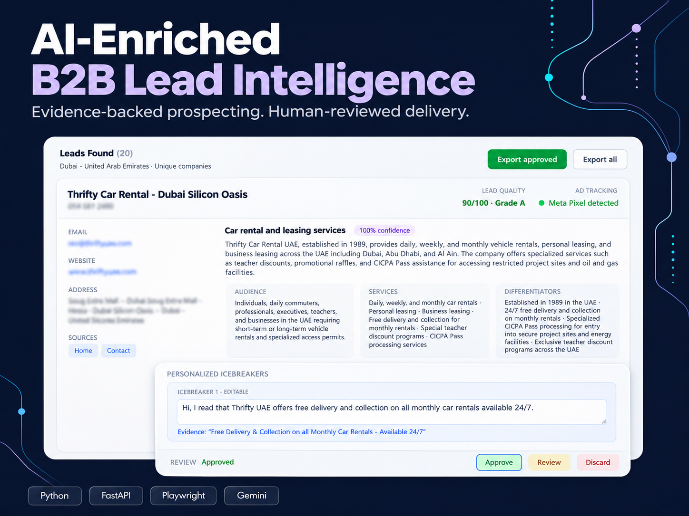
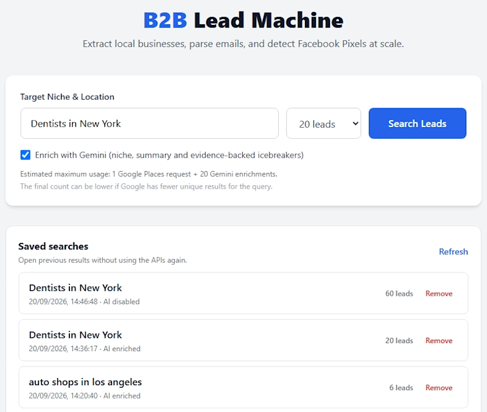
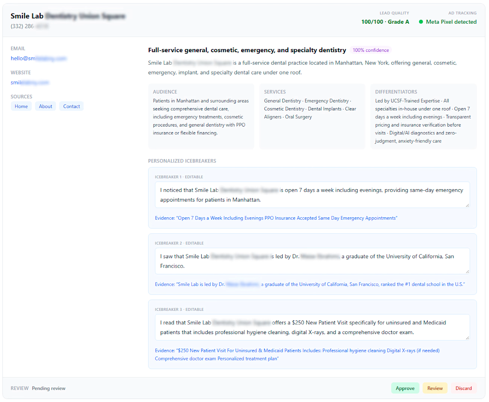

<div align="center">
  <a href="#proprietary-software" title="Read about source-code availability"></a>
  <a href="https://www.upwork.com/freelancers/~01863b330a3897a766" title="View my Upwork profile"></a>
</div>

<br>

# B2B Lead Intelligence & AI Enrichment Engine

An end-to-end lead research pipeline that transforms local business listings into enriched, evidence-backed prospect data for outbound campaigns.

Instead of delivering a basic directory export, the system combines official business discovery, live website research, technical footprint analysis, AI enrichment, deterministic scoring, and human review into a clean CRM-ready CSV.

<a id="proprietary-software"></a>

> **Proprietary software:** this public repository is a product and engineering case study. The application source code, scraping pipeline, prompts, validation rules, and operational data remain private.

Independently developed project demonstrated using publicly available business data. The businesses shown are sample prospects, not clients.

## Product Walkthrough



https://github.com/user-attachments/assets/e5ab457b-1d10-43ce-8aed-dcac9045360e

The silent walkthrough shows a saved Dubai car-rental search, company enrichment, website evidence inspection, icebreaker editing, approval and rejection, and the approved-only export.

[View the three-page sample deliverable (PDF)](assets/b2b-lead-intelligence-sample.pdf)

The public PDF includes selected records and evidence-backed hooks from an approved demonstration export. Phone numbers and email addresses are omitted from that sample.

---

## Application Preview

From search configuration and reusable batch history to evidence-backed enrichment and human review:

### Search and saved batches



### Enriched lead review



---

## The Problem

Raw business listings rarely contain enough context for effective outreach. Sales teams still need to visit websites, locate public contact information, understand each company's positioning, identify relevant sales angles, and manually clean the resulting spreadsheet.

This project automates that research workflow while keeping uncertain information explicit instead of inventing missing facts.

## What the System Does

1. **Targeted business discovery**
   - Searches by niche, city, and geographic intent through the Google Places API.
   - Preserves business names, addresses, phone numbers, websites, and Google Place IDs.
   - Uses geographic search segments and address-component filtering to collect up to 100 prospects, subject to coverage.
   - Supports deduplication by company website domain or by business location before enrichment.

2. **Multi-page website research**
   - Uses asynchronous Playwright browsers to execute JavaScript and inspect live pages.
   - Discovers relevant pages such as Home, About, and Contact.
   - Extracts visible website content and preserves source URLs for auditing.

3. **Public contact and email intelligence**
   - Finds publicly listed business emails and records where they were found.
   - Ranks email candidates using domain matching and source-page signals.
   - Keeps missing contact data clearly marked instead of filling it with guesses.

4. **Technical footprint audit**
   - Detects Meta Pixel signals after client-side JavaScript execution.
   - Converts technical findings into readable statuses rather than ambiguous `Yes/No` fields.

5. **Evidence-backed AI enrichment**
   - Uses Gemini with a structured JSON response contract.
   - Generates an exact niche classification, executive summary, target audience, core services, and up to three personalized outreach icebreakers.
   - Cross-checks generated claims against text collected from the company's website.
   - Returns `insufficient_evidence` when the available content cannot support a reliable conclusion.

6. **Lead scoring and human review**
   - Assigns a deterministic 0–100 quality score and an A/B/C grade.
   - Supports review states for approval, revision, or rejection.
   - Allows operators to refine outreach copy before final delivery.

7. **Batch operations and delivery**
   - Runs background collection jobs with live progress and cancellation support.
   - Displays completed leads incrementally without recreating existing review cards.
   - Saves previous searches locally so results can be reopened without repeating API calls.
   - Exports all leads or only approved leads to a clean CSV for CRM and outreach tools.

---

## Example Deliverable

| Data group | Example fields |
|---|---|
| Business identity | Company name, address, city, state, country, phone, website, Google Place ID |
| Contact intelligence | Public email and email source URL |
| Technical audit | Meta Pixel detection status |
| AI intelligence | Exact niche, executive summary, target audience, core services |
| Outreach personalization | Up to three evidence-backed icebreakers with source references |
| Quality control | Lead score, A/B/C grade, review status |

The commercial deliverable is a curated CSV dataset. The automation itself is not distributed as part of the standard service.

---

## Architecture

```text
Search criteria
      ↓
Google Places discovery and deduplication
      ↓
Async website navigation and page discovery
      ↓
Contact extraction and technical audit
      ↓
Structured AI enrichment and evidence validation
      ↓
Deterministic scoring and human review
      ↓
CRM-ready CSV export
```

### Technology Stack

- **Backend:** Python, FastAPI, Pydantic
- **Browser automation:** Playwright Async with bounded concurrency
- **Data source:** Google Places API (New)
- **AI enrichment:** Gemini API with structured JSON output
- **Persistence:** SQLite with WAL mode
- **Frontend:** HTML, Tailwind CSS, Vanilla JavaScript
- **Testing:** 24 unittest tests covering pipeline behavior, persistence, geographic filtering, enrichment validation, and a Chromium launch smoke test

### Engineering Highlights

- Blocking SDK operations are isolated from FastAPI's event loop.
- Browser concurrency is limited to protect memory and system stability.
- Website evidence is collected once and reused across enrichment and validation steps.
- AI output must conform to a defined schema and pass local evidence checks.
- Partial progress is persisted, reducing data loss during long-running jobs.
- Review status is stored separately from the lead payload for safer curation.
- CSV output is formatted for reliable opening in spreadsheet and outreach applications.

---

## Reliability Boundaries

- Results depend on Google Places coverage for the requested query and location.
- Only publicly available website information is collected.
- An email can be publicly sourced and syntactically valid without guaranteeing mailbox deliverability.
- Some websites block automated browsers or expose too little content for AI enrichment.
- Unsupported claims are rejected or marked as insufficient evidence.
- The current product is an operator-assisted service, not a public multi-tenant SaaS platform.

---

## Ideal Use Cases

- B2B marketing and cold email agencies
- Founders and sales teams targeting local service businesses
- Custom market research and prospect-list projects
- Campaigns that require personalized, evidence-backed outreach angles
- Technical audits for businesses missing important marketing instrumentation

---

## Work With Me

I build custom data extraction, browser automation, lead intelligence, and API integration solutions. Engagements can range from a focused test batch to a custom multi-location research campaign.

- **Upwork:** [Hire me on Upwork](https://www.upwork.com/freelancers/~01863b330a3897a766?mp_source=share)
- **Contra:** [View my Contra portfolio](https://contra.com/kauan_miranda_1uvmpwxm?referralExperimentNid=DEFAULT_REFERRAL_PROGRAM&referrerUsername=kauan_miranda_1uvmpwxm)
